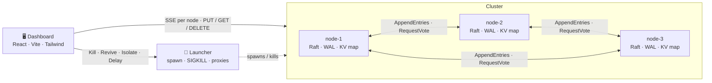
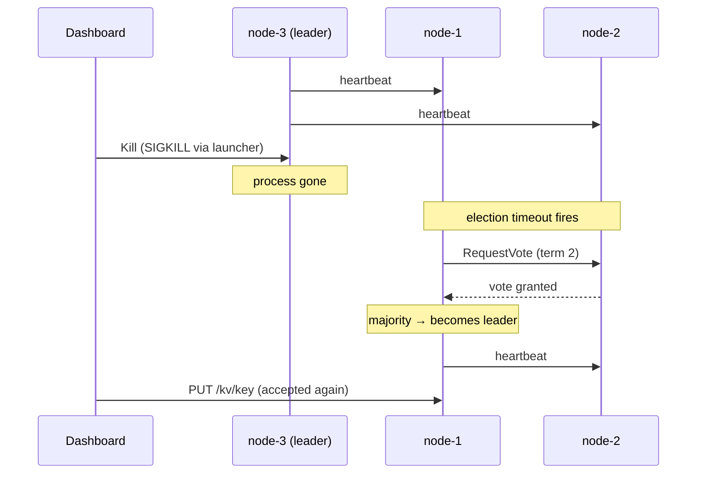

<p align="center">
  
</p>

<p align="center">
  
  
  
  
</p>

<p align="center">
  
</p>

<p align="center"><sub><b>CI / CD</b></sub></p>
<p align="center">
  <a href="https://github.com/privateMwb/RaftKV/actions/workflows/build.yml">
    
  </a>
  <a href="https://github.com/privateMwb/RaftKV/actions/workflows/frontend.yml">
    
  </a>
  <a href="https://github.com/privateMwb/RaftKV/actions/workflows/release.yml">
    
  </a>
</p>

<p align="center"><sub><b>Code Quality &amp; Safety</b></sub></p>
<p align="center">
  <a href="https://github.com/privateMwb/RaftKV/actions/workflows/sanitizers.yml">
    
  </a>
  <a href="https://github.com/privateMwb/RaftKV/actions/workflows/clang-tidy.yml">
    
  </a>
  <a href="https://github.com/privateMwb/RaftKV/actions/workflows/clang-format.yml">
    
  </a>
  <a href="https://github.com/privateMwb/RaftKV/actions/workflows/codeql.yml">
    
  </a>
</p>

<p align="center"><sub><b>Documentation</b></sub></p>
<p align="center">
  <a href="https://github.com/privateMwb/RaftKV/actions/workflows/docs.yml">
    
  </a>
</p>

<p align="center">
  
</p>

<p align="center">RaftKV is a small replicated key-value store built on <a href="https://github.com/privateMwb/RaftCore">RaftCore</a>, paired with a live web dashboard that shows leader election and log replication <i>as they happen</i>. Three processes agree on every write, survive <code>kill -9</code>, and refuse to answer rather than answer wrongly. The centerpiece is a <b>"kill this node" button</b>: stop the leader and watch the cluster elect a new one in about half a second.</p>

<br>

> [!NOTE]
> **Status: Phase 6 — complete.** Three processes elect a leader, replicate through a
> durable log, survive `kill -9`, and serve a key-value API with linearizable reads. A
> responsive dashboard (desktop and phone) shows every node's own view live, and can
> crash, revive, slow down, and partition the real processes. The Docker setup is
> included but **untested**, and nothing is deployed.

<br>

## 📑 Table of Contents

- [Features](#features)
- [How It Works](#how-it-works)
- [Requirements](#requirements)
- [Stack](#stack)
- [Installation](#installation)
- [Quick Start](#quick-start)
- [Running a 3-Node Cluster](#running-a-3-node-cluster)
- [Dashboard](#dashboard)
- [Client API](#client-api)
- [Live Cluster State](#live-cluster-state)
- [Docker](#docker)
- [Project Structure](#project-structure)
- [Roadmap](#roadmap)
- [Design Notes](#design-notes)
- [Development](#development)
- [Documentation](#documentation)
- [Contributing](#contributing)
- [Changelog](#changelog)
- [Security](#security)
- [License](#license)

<br>

## <a id="features"></a>✨ Features

- **Real consensus, real processes** — every node is an OS process running RaftCore: randomized election timeouts, `RequestVote`, `AppendEntries`, and majority commit. No simulation: the dashboard crashes and partitions the real thing.
- **Durable by construction** — each append is `fsync`ed to a write-ahead log before it is acknowledged, and `currentTerm`/`votedFor` are rewritten atomically (temp file, `fsync`, rename). A node killed with `SIGKILL` restarts from disk and catches up.
- **Linearizable reads** — `GET` goes through the leader and needs a quorum. Without one you get a `503`, never a stale answer. Opt into a node's local copy with `?stale=1`.
- **Followers redirect** — a write or read sent to a follower answers `307` with the leader in `Location`; method and body are preserved, so `curl -L` just works.
- **Live, push-based observability** — cluster state streams over Server-Sent Events. Nothing polls, and an idle cluster costs one `ping` every 2 s.
- **A dashboard that tells the truth** — it listens to *every* node and merges their views, so a cut-off old leader is shown alive, still claiming leadership, and marked **stale**, instead of being mistaken for a dead node.
- **Break it on purpose** — **Kill** (`SIGKILL`), **Revive**, **Isolate** (cut a node off while it keeps running), and a **delay slider** that slows every node-to-node link.
- **Plain-language narration** — the dashboard explains what is happening: *election in progress*, *stale leader*, *no majority*, *node catching up*.
- **Built to run on a phone** — the dashboard is responsive, and the backend runs happily under Termux.
- **Rate limiting built in** — a per-client limit on the client API (default 600 requests per 10 s), plus a 64 KiB value cap, both configurable.
- **Built on its author's own libraries** — consensus, HTTP, rate limiting and the write-ahead log are all vendored as submodules (see [Stack](#stack)).

<div align="right"><a href="#-table-of-contents"></a></div>

## <a id="how-it-works"></a>🧠 How It Works

One node is one process: a single HTTP port serves clients, peer RPC, and the live streams. Inside, a `KvNode` ties RaftCore, the on-disk log, and the key-value map together behind one mutex.



What happens when you crash the leader:



Raft internals, the observability model, and the trade-offs are written up in [docs/ARCHITECTURE.md](docs/ARCHITECTURE.md).

<div align="right"><a href="#-table-of-contents"></a></div>

## <a id="requirements"></a>📋 Requirements

- A C++23-conformant compiler and CMake 3.20+
- Git, with submodules (each library vendors its own nested submodules too)
- Node.js 22+ for the dashboard
- *(Optional)* Docker, for the container setup — currently untested

<div align="right"><a href="#-table-of-contents"></a></div>

## <a id="stack"></a>🔗 Stack

RaftKV is assembled from four libraries, vendored as git submodules under `backend/external/`:

| Library | Namespace | Role |
|---|---|---|
| [RaftCore](https://github.com/privateMwb/RaftCore) | `RaftCore` | Raft consensus: elections, log replication, commit/apply |
| [FalconHTTP](https://github.com/privateMwb/FalconHTTP) | `FalconHTTP` | HTTP server for the client API and peer RPC, outbound `HttpClient`, SSE |
| [RateThrottle](https://github.com/privateMwb/RateThrottle) | `ThrottlePro` | Rate limiting on the client API |
| [MiniDatabase](https://github.com/privateMwb/MiniDatabase) | `MiniDB` | `WriteAheadLog` backing each node's Raft log |

The dashboard is **React 19**, **Vite**, **Tailwind CSS v4** and Boxicons, with no other runtime dependencies.

<div align="right"><a href="#-table-of-contents"></a></div>

## <a id="installation"></a>📦 Installation

Clone with submodules and build the backend:

```bash
git clone --recurse-submodules https://github.com/privateMwb/RaftKV
cd RaftKV/backend
cmake -S . -B build -DCMAKE_BUILD_TYPE=Release
cmake --build build
```

Already cloned without `--recurse-submodules`? Fetch them with:

```bash
git submodule update --init --recursive
```

State lives under `data/` (`node-1.wal`, `node-1.state`); delete it for a fresh node.

<div align="right"><a href="#-table-of-contents"></a></div>

## <a id="quick-start"></a>🚀 Quick Start

The fastest way to see RaftKV work is the dashboard. From the repository root, with the backend built:

```bash
npm --prefix frontend install
node scripts/launcher.mjs --fresh      # 3 nodes + the kill/revive launcher
npm --prefix frontend run dev          # http://localhost:5173
```

Open <http://localhost:5173>, write a key, then press **Kill** on the leader. Follow [docs/DEMO.md](docs/DEMO.md) for a ten-minute guided tour.

Prefer a terminal? A single node gives you a stdin REPL:

```bash
./build/raftkv_backend      # put <k> <v> | get <k> | del <k> | status | quit
```

<div align="right"><a href="#-table-of-contents"></a></div>

## <a id="running-a-3-node-cluster"></a>🖧 Running a 3-Node Cluster

One terminal per node (from `backend/`):

```bash
./build/raftkv_backend --id node-1 --port 8101 --data data/node-1 --peer node-2=127.0.0.1:8102 --peer node-3=127.0.0.1:8103
./build/raftkv_backend --id node-2 --port 8102 --data data/node-2 --peer node-1=127.0.0.1:8101 --peer node-3=127.0.0.1:8103
./build/raftkv_backend --id node-3 --port 8103 --data data/node-3 --peer node-1=127.0.0.1:8101 --peer node-2=127.0.0.1:8102
```

Type `put k v` on whichever node is the leader (a follower answers `not leader (leader: node-N)`), then `get k` on the others. `status` shows role, term, and indices; `curl 127.0.0.1:8101/status` returns the same as JSON.

Kill the leader (`Ctrl-C` or `kill -9`), watch another node take over within a few hundred ms, restart it, and it catches up.

| Flag | Purpose |
|---|---|
| `--id`, `--port`, `--data` | Node identity, HTTP port, and data path prefix |
| `--peer id=host:port` | A peer; repeat for each. Hosts must be **IPv4 addresses** |
| `--no-repl` | Run headless until `SIGINT`/`SIGTERM` |
| `--rate-limit N` | Requests per client per 10 s (`0` = off, default `600`) |
| `--max-value-bytes N` | Value size cap (default 64 KiB) |
| `--threads N` | Server threads (default `8`; at most half may be SSE streams) |
| `--cors-origin URL` | Allow a dashboard on another origin (`*` for any) |

<div align="right"><a href="#-table-of-contents"></a></div>

## <a id="dashboard"></a>🖥️ Dashboard

```bash
npm --prefix frontend install
node scripts/launcher.mjs --fresh      # 3 nodes + the kill/revive launcher
npm --prefix frontend run dev          # http://localhost:5173
```

<!-- Add a screenshot or GIF here once captured, e.g.:
<p align="center"></p>
-->

**On a phone too:** `npm --prefix frontend run dev:host` prints a LAN address (run the launcher with `--host 0.0.0.0` so the phone can reach it, on a network you trust — anyone on it could kill your demo nodes). Details and design choices: [frontend/README.md](frontend/README.md).

The launcher can break the real cluster on purpose:

| Control | What it does |
|---|---|
| **Kill** | `SIGKILL` — a real crash; nothing is flushed or closed |
| **Revive** | Restarts the node from its WAL and state files |
| **Isolate** | Cuts a node off from its peers while it keeps running |
| **Delay slider** | Holds every chunk on every node-to-node link for N ms |

Node-to-node traffic goes through proxies the launcher owns (`--no-network` turns that off; `--public-host` sets the host used in redirect links). The dashboard's own connections bypass the proxies, so it always sees the truth.

<div align="right"><a href="#-table-of-contents"></a></div>

## <a id="client-api"></a>🔌 Client API

The same port serves clients. Keys are one percent-encoded path segment; values are the raw body (binary-safe):

```bash
curl -L -X PUT --data-binary 'hello' localhost:8102/kv/greeting   # -L follows the follower's 307 to the leader
curl -L localhost:8103/kv/greeting                                # linearizable read
curl -L -X DELETE localhost:8101/kv/greeting
curl "localhost:8103/kv/greeting?stale=1"                         # this node's local copy, no redirect
curl localhost:8101/status                                        # node state as JSON
```

| Status | Meaning |
|---|---|
| `204` / `200` / `404` | Write or delete done / value / key absent |
| `307` | Not the leader; `Location` is the leader (method and body preserved) |
| `503` + `Retry-After` | No leader known, commit timed out, leadership lost, or no quorum for a read |
| `400` / `413` / `429` | Bad key / value over 64 KiB / rate limited |

> [!WARNING]
> A `503` after a timeout does **not** mean the write failed: it may still commit. Every `/kv` response carries `X-RaftKV-Node`. A follower that hasn't yet heard from a newly elected leader answers `503` + `Retry-After: 1`; clients should retry.

<div align="right"><a href="#-table-of-contents"></a></div>

## <a id="live-cluster-state"></a>📡 Live Cluster State

State is pushed over Server-Sent Events; nothing needs polling:

```bash
curl -N localhost:8101/cluster/events   # the whole cluster, one event per change
curl -N localhost:8101/events           # just this node, one event per change
curl localhost:8101/cluster             # one-shot JSON of the cluster view
```

A stream starts with the current state, then sends an event only when something changes, plus a `ping` every 2 s while idle. `/cluster/events` events are named `cluster`:

```json
{"observer":"node-1","term":2,"leader":"node-3","quorum":true,"members":[
  {"id":"node-1","up":true,"state":{"id":"node-1","role":"follower","term":2,"leader":"node-3","commitIndex":9,"lastApplied":9,"lastLogIndex":9,"keys":3}},
  {"id":"node-2","up":false,"state":null},
  {"id":"node-3","up":true,"state":{"id":"node-3","role":"leader","term":2,"...":"..."}}]}
```

Open it on any live node; if that node dies, reconnect to another. For a dashboard on a different origin, start nodes with `--cors-origin http://localhost:5173` (or `*`). Each open stream pins one server thread (`--threads N`, default 8; at most half may be streams, extras get `503`).

<div align="right"><a href="#-table-of-contents"></a></div>

## <a id="docker"></a>🐳 Docker

`docker-compose.yml` runs the three nodes as containers with fixed IPs (the nodes' HTTP client needs dotted-IPv4 peers) and publishes `8101`–`8103`, so the dashboard works unchanged:

```bash
docker compose up --build              # first build compiles the backend
docker compose kill node-2             # crash a node
docker compose start node-2            # revive it from its volume
docker network disconnect raftkv-net raftkv-node-2   # cut it off
docker compose down -v                 # stop and delete the data
```

> [!CAUTION]
> **This has not been run by its author** (no container runtime was available while writing it). What *was* checked: the compose file parses, every node's argument list is accepted by the real binary, the `ENTRYPOINT` passes arguments through intact, and the Dockerfile's CMake flags drop the test target. The dashboard's Kill / Revive / Isolate buttons need the launcher and stay disabled with Docker. Also note the template's `init-nested-submodules.sh` clones each library's default branch, not the pinned commit.

<div align="right"><a href="#-table-of-contents"></a></div>

## <a id="project-structure"></a>🗂️ Project Structure

```
RaftKV/
├── backend/                C++ backend (CMake)
│   ├── external/           The four submodules (raftcore, falconhttp, ratethrottle, minidatabase)
│   ├── src/
│   │   ├── raft/           FilePersistentState, WalStorage (RaftCore adapters)
│   │   ├── kv/             KvCommand codec, KvStateMachine
│   │   ├── net/            HttpTransport, NodeServer, ClientApi, ClusterMonitor,
│   │   │                   RpcCodec, PercentCoding, PeerAddress
│   │   ├── node/           KvNode (RaftNode + tick loop + writes + peer RPCs), NodeSnapshot
│   │   └── main.cpp        CLI + stdin REPL
│   ├── tests/              Custom-framework suites (unit/, integration/)
│   ├── include/            App headers
│   └── data/               Runtime data (WAL files); mount as a volume in Docker
│
├── frontend/               Dashboard: React + Vite + Tailwind (see frontend/README.md)
├── scripts/                launcher.mjs + network.mjs: run the cluster, kill/revive nodes,
│                           inject delay and partitions
├── docs/                   ARCHITECTURE.md (how it works), DEMO.md (guided tour)
├── .github/                Workflows, release notes, README assets
│
├── Dockerfile              Node image (see Docker)
├── docker-compose.yml      3-node cluster, fixed IPs (untested)
├── init-nested-submodules.sh
├── .clang-format
├── .clang-tidy
├── README.md
├── CONTRIBUTING.md
├── CHANGELOG.md
├── SECURITY.md
└── LICENSE
```

<div align="right"><a href="#-table-of-contents"></a></div>

## <a id="roadmap"></a>🗺️ Roadmap

| Phase | Goal | Status |
|:-:|---|:-:|
| 0 | Repo scaffold; one build linking all four libraries | ✅ |
| 1 | Single node, no networking: RaftCore + WAL + in-memory map state machine | ✅ |
| 2 | Multi-node: peer RPC over FalconHTTP, static peer list, 3-node cluster | ✅ |
| 3 | Client API: `GET`/`PUT`/`DELETE` on the leader, follower redirects, rate limiting | ✅ |
| 4 | Live cluster-state endpoint over SSE | ✅ |
| 5 | Frontend dashboard with the kill-node button | ✅ |
| 6 | Stretch: network delay/partition controls, per-node Docker | ✅ <sub>Docker untested</sub> |

<div align="right"><a href="#-table-of-contents"></a></div>

## <a id="design-notes"></a>🔬 Design Notes

The numbers below were measured on real processes through the launcher's proxies (one-way delay on every link). Full write-up in [docs/ARCHITECTURE.md](docs/ARCHITECTURE.md).

| One-way delay | Writes | Leadership |
|---|---|---|
| 0 ms | ~8 ms | stable |
| 40 ms | 80–160 ms (one to two round trips) | stable |
| 80 ms and up | fail with `503` | elections every few hundred ms |

At 80 ms a heartbeat round trip (≥160 ms) outlasts the shortest election timeout (150 ms), so followers time out and the cluster flaps. **Safety holds throughout** — nothing acknowledged is lost and nothing stale is served; only availability suffers. The rule is the standard one: election timeouts must be several times the network round trip.

**Key decisions**

- **One mutex around `RaftNode`.** RaftCore is single-threaded by design. Simple and correct, but an `fsync` inside the lock also pauses heartbeats — which is why values are capped at 64 KiB by default.
- **Peer RPC is HTTP with a small versioned binary body**, one connection per RPC and one sender thread per peer. A newer `AppendEntries` replaces an older one still queued; votes are never dropped.
- **Static membership.** The cluster is the `--peer` list; nodes cannot join or leave at runtime.
- **The launcher, not an admin endpoint, kills nodes.** A "kill me" endpoint on every node would be an unauthenticated foot-gun.

**Known limits** — no snapshots or log compaction (a long-dead node is caught up from the full log in one request, which must fit FalconHTTP's 10 MiB body limit); no membership changes; peer addresses are dotted IPv4; one in-flight RPC per peer caps heartbeat rate at the round-trip time; writes that time out may still commit, and there is no request deduplication.

<div align="right"><a href="#-table-of-contents"></a></div>

## <a id="development"></a>🛠️ Development

**Backend tests** (from `backend/`, after building):

```bash
./build/raftkv_tests            # all suites
./build/raftkv_tests list       # list suites and categories
./build/raftkv_tests <name>     # one suite or category
```

**Frontend** (from the repository root):

```bash
npm --prefix frontend run lint
npm --prefix frontend test
npm --prefix frontend run build
```

Formatting and static analysis are enforced in CI via `.clang-format` and `.clang-tidy`, and the sanitizer workflow builds the backend with ASan/UBSan and TSan. See [CONTRIBUTING.md](CONTRIBUTING.md) for what CI does and doesn't cover.

<div align="right"><a href="#-table-of-contents"></a></div>

## <a id="documentation"></a>📖 Documentation

| Document | What's inside |
|---|---|
| [docs/ARCHITECTURE.md](docs/ARCHITECTURE.md) | How it works: Raft in one page, observability, fault injection, measurements, trade-offs |
| [docs/DEMO.md](docs/DEMO.md) | A ten-minute guided tour: crash the leader, partition it, slow the network, lose the majority |
| [frontend/README.md](frontend/README.md) | Dashboard internals and design choices |
| [CONTRIBUTING.md](CONTRIBUTING.md) | Setup, tests, code style, and the pull request checklist |
| [SECURITY.md](SECURITY.md) | Security model, scope, and how to report a vulnerability |
| [CHANGELOG.md](CHANGELOG.md) | Notable changes per release |

<div align="right"><a href="#-table-of-contents"></a></div>

## <a id="contributing"></a>🤝 Contributing

Issues and pull requests are welcome. [CONTRIBUTING.md](CONTRIBUTING.md) covers setup, running the tests, code style, and a pull request checklist. In short:

- Run `./build/raftkv_tests` and format C++ with the repo's `.clang-format` — CI checks formatting but **does not run the backend tests**, so please run them locally
- For frontend changes, run `npm --prefix frontend run lint` and `npm --prefix frontend test`
- If you touch the Raft path, try the crash and partition scenarios in [docs/DEMO.md](docs/DEMO.md) before pushing

<div align="right"><a href="#-table-of-contents"></a></div>

## <a id="changelog"></a>📝 Changelog

Notable changes are recorded in [CHANGELOG.md](CHANGELOG.md); release notes are published on the [Releases](https://github.com/privateMwb/RaftKV/releases) page.

<div align="right"><a href="#-table-of-contents"></a></div>

## <a id="security"></a>🔒 Security

Please don't report a suspected vulnerability in a public issue. Use GitHub's private reporting instead — this repository's **Security** tab, then **Report a vulnerability** — so it can be fixed before it's disclosed. Details are in [SECURITY.md](SECURITY.md).

> [!WARNING]
> RaftKV is a learning and demonstration project: there is **no authentication or TLS**, and `--host 0.0.0.0` exposes node-killing controls to your whole network. Read the security model in [SECURITY.md](SECURITY.md) before running it anywhere but your own machine.

<div align="right"><a href="#-table-of-contents"></a></div>

## <a id="license"></a>📄 License

MIT — see [LICENSE](LICENSE) for details.

<p align="center">
  <sub>Built with C++23 and React</sub>
</p>

<p align="center">
  <a href="#-table-of-contents"></a>
</p>
