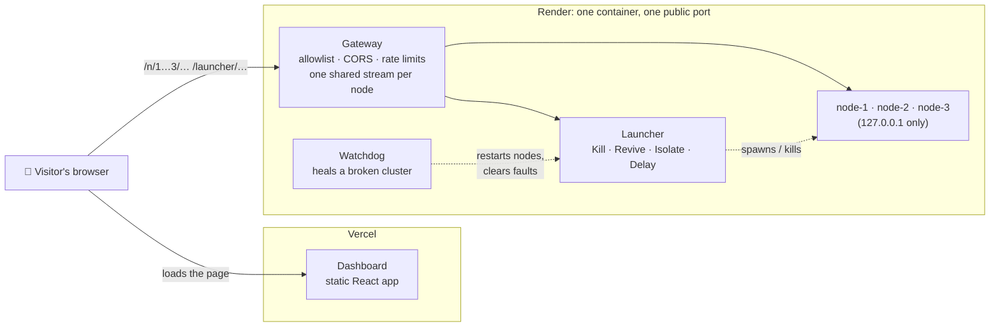

# Deploying the hosted demo

This puts RaftKV on the internet as a public demo: the **backend** (three real nodes plus
the controls) on [Render](https://render.com), and the **dashboard** on
[Vercel](https://vercel.com). Visitors open the dashboard, write keys, and press **Kill**
on the leader.

> [!NOTE]
> **What has and hasn't been tested.** The gateway, the watchdog and the dashboard's
> client logic were tested locally against real backend nodes (see
> [What was verified](#what-was-verified)). **The Docker image has not been built by its
> author, and nothing has been deployed to Render or Vercel.** The `Demo image` GitHub
> workflow builds the image and runs [`scripts/check-demo.sh`](../scripts/check-demo.sh)
> against it on every relevant push, and you can run the same script against your Render
> URL in step 5. Treat the first deploy as the real test.

## How it fits together



Render exposes a single public port per service, but the dashboard talks to every node and
to the launcher. [`scripts/gateway.mjs`](../scripts/gateway.mjs) bridges that: node *k* is at
`/n/k/…` and the launcher at `/launcher/…`, all on one origin. The nodes and the launcher
listen on `127.0.0.1` inside the container and are reachable only through the gateway.

## Before you start

- The repository is pushed to GitHub (Render and Vercel both deploy from it).
- Decide the Render service name. The blueprint uses `raftkv-demo`, which gives
  `https://raftkv-demo.onrender.com` if the name is free. Render appends a suffix when it
  isn't, so read the real URL off the service page after step 1.

## 1. Deploy the backend to Render

1. In Render, choose **New → Blueprint** and select this repository. Render reads
   [`render.yaml`](../render.yaml): one Docker web service built from
   [`Dockerfile.demo`](../Dockerfile.demo), with `/healthz` as its health check.
2. When prompted for `ALLOWED_ORIGINS`, enter a placeholder (for example
   `https://example.com`). You will replace it in step 4, once Vercel gives you a URL.
3. Wait for the build (several minutes: it compiles the C++ backend).

Prefer to set it up by hand? **New → Web Service**, runtime **Docker**, Dockerfile path
`./Dockerfile.demo`, health check path `/healthz`, and add the environment variables from
[the reference below](#configuration-reference).

## 2. Check the backend

```bash
scripts/check-demo.sh https://raftkv-demo.onrender.com
```

It waits out a cold start, then checks that a leader is elected, that a write sent to a
follower is redirected through the public URL and succeeds, that the nodes' peer-to-peer
routes are **not** reachable, and that the live stream delivers state. Fix anything that
fails before moving on. The most likely failures:

| Failing check | Likely cause |
|---|---|
| `follower redirects to the leader through the public URL` | `PUBLIC_BASE_URL` is wrong. It defaults to Render's `RENDER_EXTERNAL_URL`; set it explicitly if you use a custom domain. |
| `a leader is elected within 60s` | The container is starved of CPU (see [free plan](#the-free-plan)) or a node failed to start; read the service logs. |

## 3. Deploy the dashboard to Vercel

1. In Vercel, **Add New → Project**, import the repository.
2. Set **Root Directory** to `frontend`. Vercel detects Vite; the build command and output
   directory need no changes. [`frontend/vercel.json`](../frontend/vercel.json) adds the
   rewrite the dashboard's client-side routes need.
3. Under **Environment Variables**, add (replace the host with your real Render URL):

   | Name | Value |
   |---|---|
   | `VITE_NODE_URLS` | `https://raftkv-demo.onrender.com/n/1,https://raftkv-demo.onrender.com/n/2,https://raftkv-demo.onrender.com/n/3` |
   | `VITE_LAUNCHER_URL` | `https://raftkv-demo.onrender.com/launcher` |

4. Under **Settings → General → Node.js Version**, choose 22.x.
5. Deploy, and note the URL (for example `https://raftkv.vercel.app`).

> [!IMPORTANT]
> Vite reads `VITE_*` variables when it **builds**, not when the page loads. If you change
> them later, redeploy the dashboard.

## 4. Allow the dashboard to call the backend

Browsers refuse cross-origin requests unless the server says otherwise, and the gateway
says so only for the origins you list. In Render, set `ALLOWED_ORIGINS` to the dashboard's
**exact origin**: scheme and host, no path, no trailing slash.

```
ALLOWED_ORIGINS=https://raftkv.vercel.app
```

Several origins are comma-separated (a custom domain and the Vercel URL, say). Preview
deployments get their own `*.vercel.app` URLs, so add one only if you want it to work.
Render restarts the service when you save, which also resets the demo cluster.

## 5. Verify end to end

```bash
scripts/check-demo.sh https://raftkv-demo.onrender.com https://raftkv.vercel.app
```

With the dashboard origin it also checks that CORS allows exactly that origin on a normal
request and on the preflight a browser sends before a write, and refuses any other. Then
open the dashboard, write a key, and press **Kill** on the leader.

## Configuration reference

All settings are environment variables on the Render service.

| Variable | Default | Meaning |
|---|---|---|
| `PORT` | `10000` | Public port. Render sets this itself. |
| `PUBLIC_BASE_URL` | `$RENDER_EXTERNAL_URL`, else `http://127.0.0.1:$PORT` | The demo's public URL. Followers use it to tell clients where the leader is. |
| `ALLOWED_ORIGINS` | *(none)* | Origins allowed to call the gateway from a browser. Unset means no cross-origin access at all. `*` allows any. |
| `RESET_AFTER_SECONDS` | `180` | A cluster left broken this long is healed (see below). |
| `TRUST_PROXY_HOPS` | `1` | Trusted proxies in front of the gateway; decides which `X-Forwarded-For` entry is the client. |
| `NODES` | `3` | Cluster size. The dashboard expects three. |
| `BINARY`, `DATA_DIR` | set by the image | Backend binary and node data directory (wiped on every start). |

## What the public can do

A public demo means anyone can press the buttons. That is the point of it, and it is safe
because of what the gateway does and does not forward.

| Visitors can | Visitors cannot |
|---|---|
| Read and write keys through any node | Reach the nodes' peer-to-peer routes (`/raft/…`) |
| Kill, stop and revive nodes | Stop the whole cluster, or reach any launcher route the dashboard doesn't use |
| Delay, isolate and partition the network | Call the backend from a web page on an origin you didn't list |
| Watch live cluster state | Send cookies or credentials through to the backend |

Limits, all per client unless noted (defaults in
[`gateway.mjs`](../scripts/gateway.mjs)):

| Limit | Value |
|---|---|
| Proxied requests | 600 per minute |
| Destructive controls (kill, isolate, delay, ...) | 20 per minute, and 120 per minute across all clients |
| Concurrent live streams | 12, and 300 across all clients |
| Request body | 70 KiB (the backend's own cap is 64 KiB per value) |
| Backend response time | 10 s, then `504` |

**Live streams are shared.** The backend allows only a few live streams per node, so
direct connections would refuse the fifth visitor. The gateway keeps one stream per node
and fans it out, so any number of visitors cost each node a single connection.

**A broken demo heals itself.** If a node has been down, or a link cut or slowed, for
`RESET_AFTER_SECONDS` straight, the watchdog restarts the node and clears every fault.
Someone who crashes the cluster and walks away won't leave it broken for the next visitor.

**Nothing persists.** Node data is wiped on every start, so there is nothing for visitors
to damage or leak. See [SECURITY.md](../SECURITY.md#hosted-demo) for the full security
stance.

## The free plan

`render.yaml` uses `plan: free` so that it costs nothing to try. Two consequences:

- **It sleeps** after a stretch with no traffic and takes a while to wake. The cluster
  restarts from scratch each time (it always does), and `check-demo.sh` waits for it.
- **It has very little CPU.** Raft's election timeouts are a few hundred milliseconds, so a
  starved container can miss heartbeats and elect leaders over and over. If the dashboard
  shows constant elections, change `plan: free` to `plan: starter` in `render.yaml`.

## Troubleshooting

| Symptom | What to check |
|---|---|
| Dashboard loads but shows no nodes, and the browser console shows a CORS error | `ALLOWED_ORIGINS` must match the dashboard's origin exactly: `https://`, no trailing slash, no path. Run `check-demo.sh` with the origin. |
| Dashboard shows the nodes as unreachable, no CORS error | `VITE_NODE_URLS` or `VITE_LAUNCHER_URL` is wrong, or was changed without redeploying. Open `<render-url>/n/1/status` in a browser. |
| Requests fail with a mixed-content error | An `http://` URL was used. Use the `https://` Render URL everywhere. |
| `429 too many requests` | A rate limit was hit; the `Retry-After` header says how long to wait. If *everyone* is limited together, see the next row. |
| Everyone shares one rate-limit bucket | `TRUST_PROXY_HOPS` doesn't match the proxies in front of the gateway, so all clients look like one. The default assumes one proxy. Adjust it to what your host actually sends in `X-Forwarded-For`. |
| `503 too many live streams` | One client opened more than 12 streams (many tabs), or the 300 total was reached. |
| Cluster keeps re-electing | CPU starvation; see [the free plan](#the-free-plan). |

## Running it locally first

You can rehearse the whole setup without Docker, Render or Vercel. With the backend built:

```bash
# Terminal 1: the demo server (launcher + 3 nodes + gateway) on :10000
PUBLIC_BASE_URL=http://localhost:10000 ALLOWED_ORIGINS=http://localhost:5173 \
  node scripts/demo-server.mjs

# Terminal 2: the dashboard, pointed at it
VITE_NODE_URLS=http://localhost:10000/n/1,http://localhost:10000/n/2,http://localhost:10000/n/3 \
VITE_LAUNCHER_URL=http://localhost:10000/launcher \
  npm --prefix frontend run dev

# Terminal 3: check it
scripts/check-demo.sh http://localhost:10000 http://localhost:5173
```

Or with Docker (the same image Render builds):

```bash
docker build -f Dockerfile.demo -t raftkv-demo .
docker run --rm -p 10000:10000 -e ALLOWED_ORIGINS=http://localhost:5173 raftkv-demo
```

## What was verified

Tested locally, against the real backend binary:

- **Gateway and watchdog:** 109 automated tests, including a check that deliberately
  breaking the allowlist makes them fail. They cover every route that is and isn't
  forwarded, CORS, each limit, and every live-stream behavior.
- **The whole stack through one port:** launcher, three real nodes and gateway, with
  `curl`: follower redirects land back on the public URL, peer RPC is unreachable, CORS
  headers are not duplicated, killing a node ends its viewers' streams, the watchdog
  revives it, and the control rate limit refuses the excess.
- **Stream sharing:** eight viewers on one node cost it one connection (two sockets,
  counted from `/proc/net/tcp`), and none once they leave. Eight clients going straight to
  the node (with one stream already open) got three streams and five `503`s.
- **The dashboard's own client code** (`buildConfig` and `ClusterWatcher`, the logic the
  React app runs) pointed at the gateway: it saw the steady state, the leader's death, the
  new election, the revival, and produced the expected event feed.

Not verified, and where it will show up:

- **`Dockerfile.demo`:** the `Demo image` workflow builds and checks it. The CMake flags it
  uses were built and run locally.
- **Render and Vercel behavior:** your first deploy and `check-demo.sh`.
- **The real browser:** CORS preflight was checked with `curl`, not a browser. Open the
  deployed dashboard once to confirm.
- **`TRUST_PROXY_HOPS=1`** matching what Render actually sends in `X-Forwarded-For`.
- **Image builds track the libraries' latest `main`**, not the commits this repository pins
  (the same limitation as the existing `Dockerfile`; see `init-nested-submodules.sh`).
